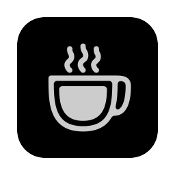

# Coffee

_Keep your Mac awake, one cup at a time_

--------------------------------------------------------------------------------

## Build

    ./script/build
    open .build/release/Coffee.app

## Features

* It uses [power assertions][IOPMLib] to keep your Mac awake.

## Previewing the Animations

    ./script/preview

renders the cup animations (turn on, steam loop, turn off, a full cycle) as animated GIFs and
keyframe sheets, on light and dark menu bars, and opens them in your browser. It uses the app's
own drawing code, so there is no need to run the app after every change. The start and stop
animations and the steam loop are keyframe tables in [CupAnimation.swift](Sources/Coffee/CupAnimation.swift);
the app blends smoothly from one keyframe to the next.

## Using It

Pick a duration from the menu, from 15 minutes to 12 hours or Forever, and the cup fills with a
pouring sound. While Coffee is brewing, the
menu title counts down the time left, and the cup in the menu bar empties as time runs out.
**Turn Off** (or clicking the active duration again) lets the Mac sleep again right away, and the
cup tips over and spills. When the timer runs out, the coffee drains away instead.

**Preferences → Steam** chooses between three steam curls (the default) and only the one in the
middle. **Preferences → Sound Effects** turns the pouring sound off.

## Saving Battery

By default Coffee keeps both the Mac and its screen awake. To save battery, you can keep the Mac
awake with the screen off:

* **Turn Off Screen Now** (in the menu while Coffee is brewing) turns the screen off right away.
  The Mac keeps running, and moving the mouse or pressing a key brings the screen back.
* **Preferences → Keep Screen On**, when switched off, lets the screen turn off on its normal
  schedule while the Mac stays awake.

Depending on your Lock Screen settings the Mac may ask for a password when the screen comes back.
Closing the lid of a laptop still puts it to sleep.

## License

Coffee is free software, licensed under the [GNU General Public License v3.0](LICENSE.txt).

[IOPMLib]:
https://developer.apple.com/library/mac/documentation/IOKit/Reference/IOPMLib_header_reference/
